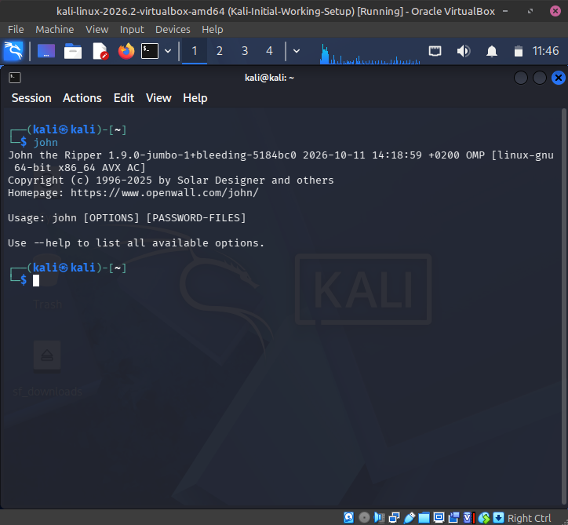
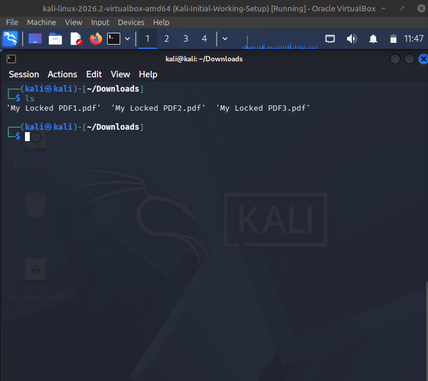
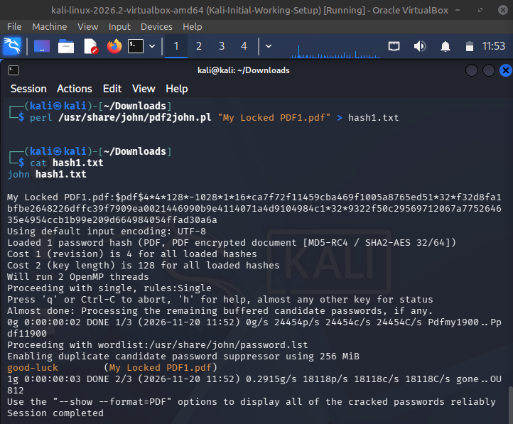
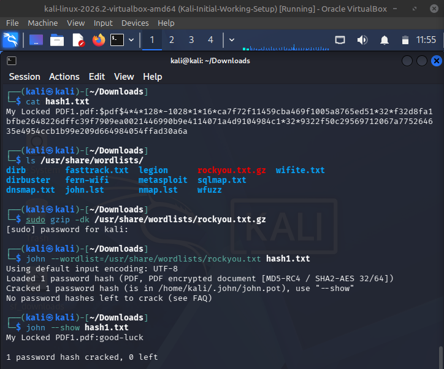
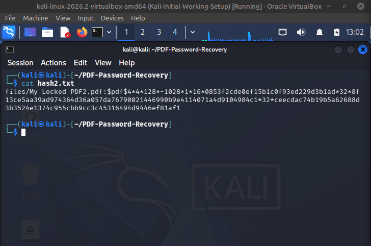
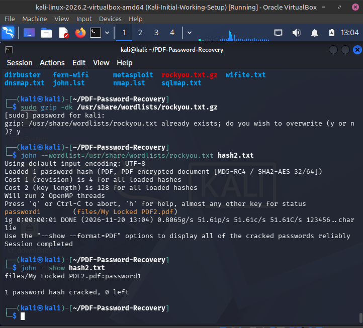
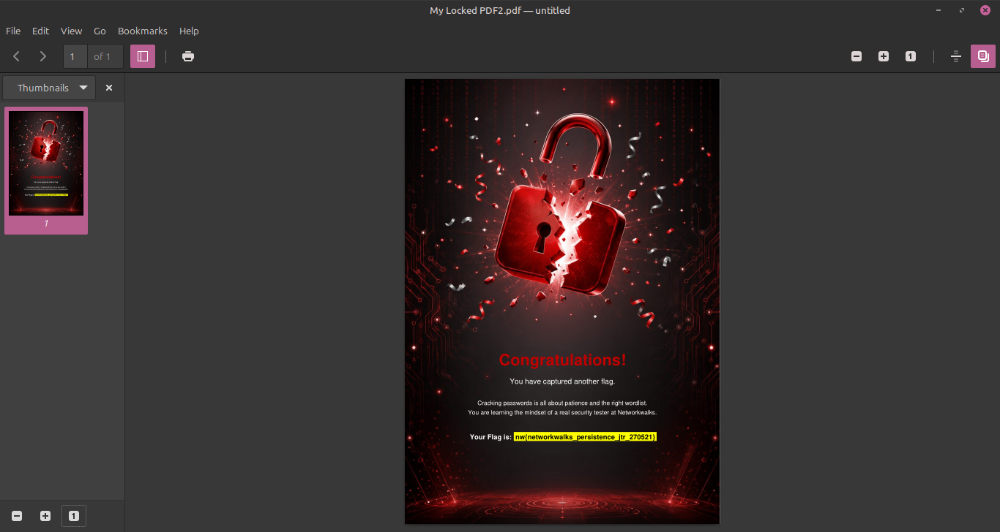
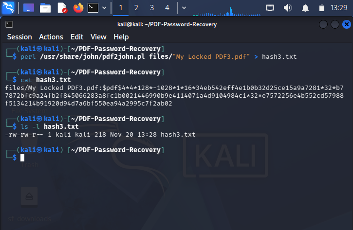
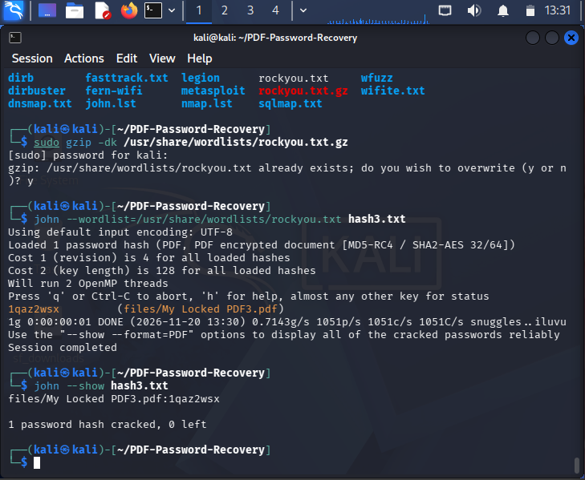

# PDF Password Recovery - JTR
## 1. Introduction

This practical demonstrates PDF password recovery using John the Ripper on Kali Linux. Three password-protected PDF files were examined using hash extraction and dictionary-based password auditing.

## 2. Objectives

- Install and configure John the Ripper.
- Extract password hashes from three PDF files.
- Perform dictionary-based password auditing.
- Examine and document the results.
- Verify any recovered passwords by opening the corresponding PDFs.

## 3. Tools and Environment

| Tool | Purpose |
|---|---|
| Kali Linux | Operating system |
| John the Ripper | Password auditing |
| pdf2john | PDF hash extraction |
| RockYou wordlist | Dictionary attack |
| Terminal | Command execution |

## 4. Methodology

### Step 1: Environment Setup

John the Ripper was checked and installed on Kali Linux.

### Step 2: PDF Hash Extraction

The pdf2john utility was used to extract password hashes from the three PDF files.

### Step 3: Dictionary Attack

John the Ripper was used with the RockYou wordlist to attempt password recovery.

### Step 4: Result Verification

The `john --show` command was used to examine the recovery results. Recovered passwords were tested by opening the corresponding PDF files.

## 5. Experimental Results

### PDF 1

- File name: My Locked PDF1.pdf
- Hash extraction: Done

- Attack status: Done
- Password recovery: Done

- PDF verification: Done

### PDF 2

- File name: My Locked PDF2.pdf
- Hash extraction: Done

- Attack status: Done
- Password recovery: Done

- PDF verification: Done

### PDF 3

- File name: My Locked PDF3.pdf
- Hash extraction: Done

- Attack status: Done
- Password recovery: Done

- PDF verification: Done

## 6. Conclusion

The practical demonstrates the use of John the Ripper for auditing PDF password security. The effectiveness of dictionary-based recovery depends on password complexity and whether the password is present in the selected wordlist.

Final recovery results will be documented after completing all three experiments.
